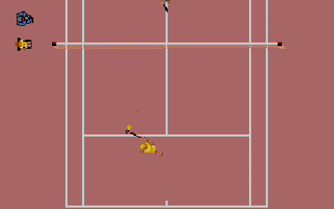
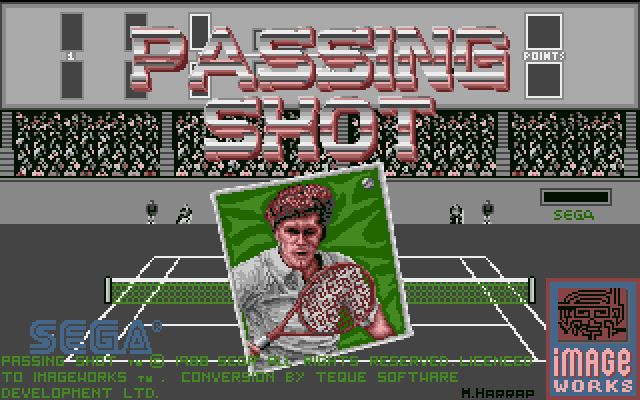
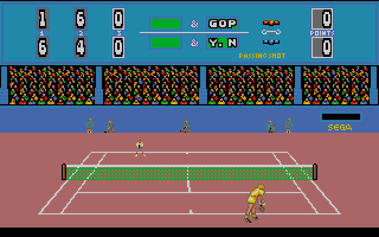
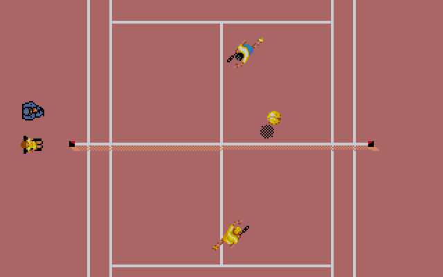
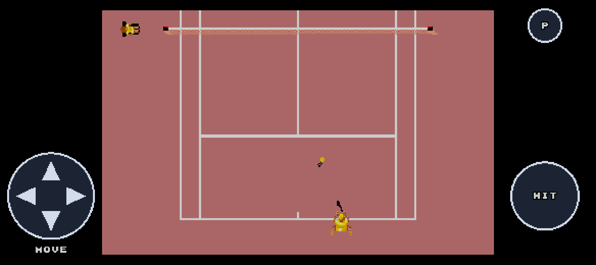

# Passing Shot Go

A native Go/Ebitengine remake of the Amiga tennis game **Passing Shot** for
desktop and Android. It includes singles, cooperative doubles, service scenes,
deuce, tie-breaks, stage progression, championship and Game Over presentation.



[Watch the 90-second presentation](media/passingshot-presentation.mp4)

| Title | Close-up service |
| --- | --- |
|  |  |

| Overhead rally | Android controls |
| --- | --- |
|  |  |

## Prepare the resources

The original ADF and reconstructed assets are not included. Follow
[the asset setup guide](docs/ASSET_SETUP.md) before the first build.

## Desktop

Go 1.26 or newer and the normal Ebitengine desktop prerequisites are required.

```sh
make extract ADF="/path/to/Passing Shot.adf"
make run
make build
./build/desktop/passingshot
```

Useful launch options:

```sh
go run ./cmd/passingshot -demo -level 1
go run ./cmd/passingshot -touch
go run ./cmd/passingshot -silent
```

## Controls

| Action | Keyboard |
| --- | --- |
| Move or select | Arrow keys |
| Serve, hit or confirm | Space, right Ctrl, right Alt; Enter in menus |
| Choose a shot | Hold Fire with Up, Down, Left or Right |
| Enter a name | Select letters and Fire, or Shift + letters |
| Join a second player | 2 or the second gamepad's Fire button |
| Second player | WASD / F |
| Pause or resume | P or Escape; Fire also resumes |
| Restart / return to title while paused | R / Q |
| Back in menus | Backspace or Escape |
| Mute / fullscreen | M / F11 |

| Direction held with Fire | Shot |
| --- | --- |
| None or Up | Flat drive |
| Down | Lob |
| Left | Slice |
| Right | Topspin |

Standard gamepads support the stick, D-pad, bottom face button and Start. Two
human players cooperate in doubles against the computer.

## Android

Install Android SDK Platform 36, Build Tools 36, a compatible NDK and JDK 17.

```sh
./scripts/build-android.sh
./scripts/run-android.sh -reuse-aar -serial "$ANDROID_SERIAL"
```

The APK is written to `android/app/build/outputs/apk/debug/app-debug.apk`.
The landscape layout uses a virtual D-pad and a context-sensitive SERVE/HIT
button. Movement and hits accept simultaneous touches; Android Back pauses.

## Presentation media

With FFmpeg installed, regenerate the local presentation with:

```sh
make presentation
```

## Original game credits

Passing Shot is an original Sega game. The Amiga edition was published by Image
Works. Its original name, program, graphics, music, audio and game data remain
the property of their respective copyright holders. This independent fan remake
is not affiliated with or endorsed by the original rights holders.

